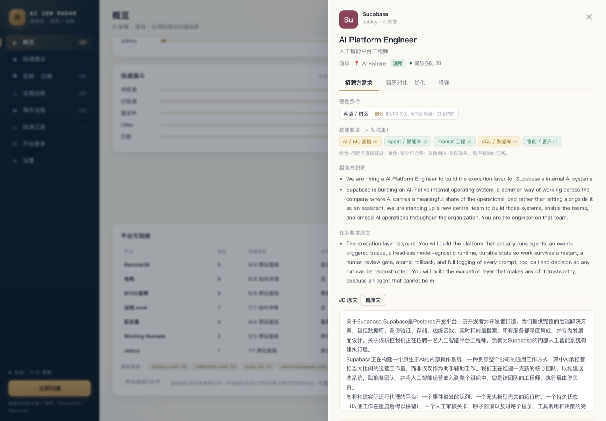
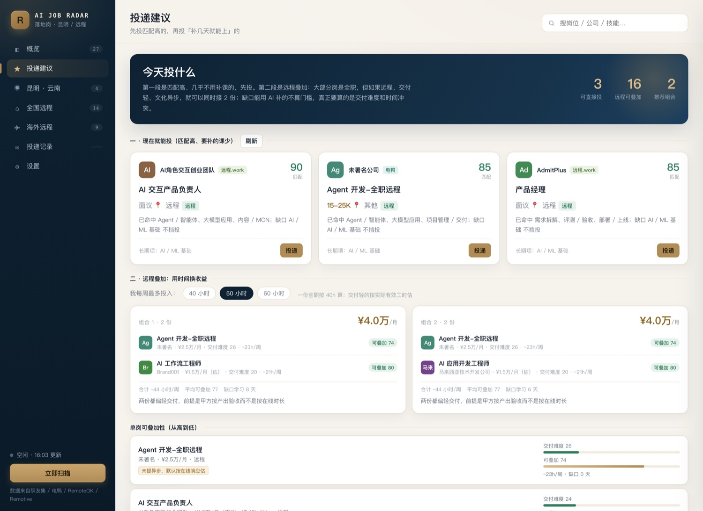
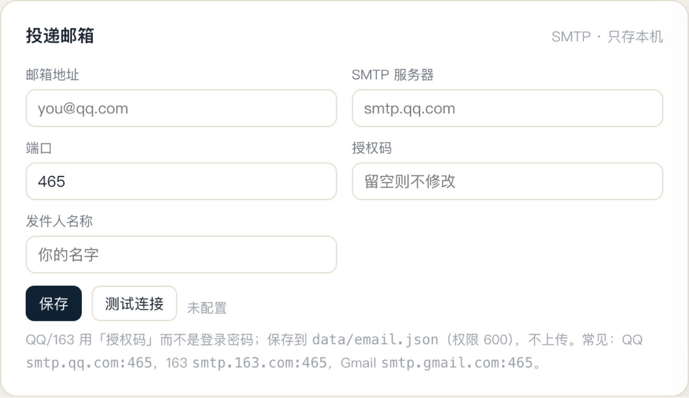
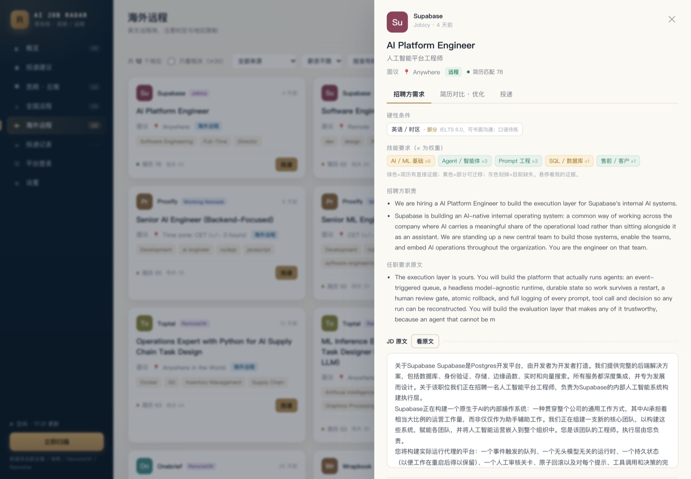

# Job Radar

面向**任意岗位关键词**的本地求职工作台：多平台扫描、聚合、简历加权匹配、远程叠加建议、定制简历、英文 JD 翻译。
**任何人 fork 后，改一份 `profile.json` 和放一份 PDF 简历，就能用它搜自己的岗位。**

纯本地运行，Node 内置能力，零 npm 依赖，数据存 SQLite。



---

## 快速开始

```bash
git clone <repo> job-radar
cd job-radar
node server.mjs          # 或 ./start.sh
# 打开 http://127.0.0.1:7788
```

要求：Node ≥ 22.5（用到内置 `node:sqlite`）。首次启动若岗位库为空会自动扫一轮。

可选依赖：
- **Chrome / Chromium**：生成定制简历 PDF 需要；默认找系统 Chrome，也可 `CHROME_PATH=...`
- **Playwright**（全局或项目内）：BOSS 登录窗口/扫描窗口需要；没有它时其他功能正常
- **BOSS 扫描**：需要本机 Chrome 支持 `--load-extension`

### 换成你自己的简历（3 步）

1. 把简历 PDF 放进 `data/resumes/`
2. 打开「设置 → 简历画像」，把 JSON 改成你的信息（或直接编辑 `config/profile.json`）
3. 保存 → 匹配分、定制简历、求职信会全部按你的画像重算

`config/profile.json` 是模板；`data/profile.json` 是界面保存后的覆盖文件（优先读取，已在 `.gitignore` 里）。
字段说明：

```jsonc
{
  "name": "你的名字",
  "title": "一句话定位",
  "location": "昆明", "remote": true,
  "years": 3, "education": "本科", "english": "CET-6",
  "contact": { "phone": "", "email": "", "site": "", "github": "" },
  "skills": {
    // level: 0=没有 / 1=会用 / 2=能交付 / 3=有硬证据
    "agent": { "level": 2, "evidence": "做过 2 条 Agent 工作流" }
  },
  "summary": ["现在：…", "判断：…", "作品：…", "方向：…"],
  "experiences": [{ "company": "公司", "role": "岗位", "period": "2022 – 2024", "bullets": ["…"] }],
  "projects": [{ "name": "项目", "period": "", "bullets": ["…"] }],
  "educationHistory": [{ "school": "…", "major": "…", "degree": "本科", "period": "…" }],
  "languages": ["中文（母语）"],
  "keywords": ["Agent 工作流", "Prompt"],
  "method": [["01", "画流程…"], ["02", "定验收…"]]
}
```

技能 `level` 直接决定加权匹配：2 以上算命中、1 算部分、0 算缺失。

---

## 功能

### 1. 搜索关键词驱动

「设置 → 搜索关键词」填任意关键词，逗号分隔，例如：

```
产品经理, Java 开发, 会计, 新媒体运营
```

- 职友集、中华英才、电鸭、远程.work、海外站都按这组词扫描
- 海外站会自动把中文词扩成英文（产品经理 → product manager）
- 换词不会删除旧岗位，方便多轮汇总
- BOSS / 小红书在「平台登录」页单独填词（登录态扫描）
- 简历匹配仍然按你的画像算，但岗位筛选不再限定 AI

### 2. 搜索方向是主控，不是普通输入框

- 顶部常驻「当前搜索方向」：关键词、城市、是否含海外
- 改方向必须走「调整方向」弹层，会明确写出影响：保存方向只影响下一轮；重新扫描才会重建整个列表、相关度和投递建议
- 「保存并重新扫描」需要勾选确认，不能顺手点
- 只保存不重扫时，顶部会显示「方向已改 · 尚未重扫」，避免误以为结果已更新
- 顶部搜索框只筛选当前已抓到的岗位，不触发扫描
- 换词不会删除旧岗位；想恢复可点「恢复上一次搜索方向」

### 3. 多源岗位聚合

| 通道 | 来源 | 登录 |
|---|---|---|
| 昆明 / 云南 | 职友集 jobui.com、中华英才 chinahr.com | 否（按关键词） |
| 全国远程 | 电鸭 eleduck.com、远程.work | 否 |
| 海外远程 | RemoteOK、Remotive、Jobicy、Working Nomads | 否 |
| 昆明 / 云南 | BOSS直聘 | **需要**（登录态 + 扩展） |
| 昆明 / 远程 | 小红书招聘笔记 | **需要**（登录态 + 扩展） |

职友集卡片带原站链接（Boss / 智联 / 国家平台）；缺链接时「补原站链接」会回填，不需要登录。

### 4. 登录平台：可扫描 vs 付费投递

平台登录页分两组：

- **可登录扫描**：BOSS直聘、小红书。按全局关键词抓取，高风险。
- **付费平台**：We Work Remotely、58同城、猎聘、智联招聘、前程无忧。这类平台常把投递/简历查看/刷新放在会员或付费包里；**不付费可能无法投递**。工具只打开原站，不代付、不绕过付费墙，也不做扫描适配。

We Work Remotely 按你的说明“投递简历需要付费会员”处理：只打开官网，不登录、不扫描、不代付。

### 5. BOSS 登录态扫描（可选，高风险）

BOSS 会检测 CDP：Playwright 一连接，页面约 10 秒后被导航到 `about:blank`。所以这里**全程不用 Playwright**：

- 登录窗口：原生 Chromium，独立 profile（`data/browser/zhipin`）
- 扫描窗口：同一 profile + `--load-extension=extension/`
- 扩展在页面内读卡片 → `bg.js` POST 到本地 `/api/extension/ingest`
- 支持**多关键词**（逗号分隔，最多 5 个，各开一个标签页）与 1–3 页

首次使用：「平台登录」→ 勾选风险 → 打开登录窗口 → 登录 → **用「关闭窗口」按钮**（会优雅退出并落盘 Cookie）→「用扩展扫描」。
直接强杀 Chrome 会丢登录态。

**风险**：平台协议通常禁止自动化访问，可能限流/封号；登录态只存本机；工具不自动投递。

### 6. 简历加权匹配

匹配分 0–100，拆成 AI 能力 35% / 工程部署 20% / 业务交付 25% / 硬性条件 20%。
每项要求按出现位置给权重：标题 ×4、任职要求 ×3、职责 ×2；命中 1、部分 0.55、缺失 0。
没有 JD 的来源会标「低置信」并封顶 55。

岗位列表可按「简历匹配」排序；抽屉里有逐项对照、缺口证据、优化建议。

### 7. 远程叠加建议

第二段不是「学几天再投」，而是**能不能同时接两份远程全职**：

- 交付难度：驻场/售前 +32、时区重叠 +22、管理岗 +16、会议密度 +12；async/结果导向 −22、兼职/项目制 −18
- 有效周工时 = `16 + 难度 × 0.25`
- 组合约束：总工时 ≤ 预算（40/50/60h）、最多 1 份时区重叠、最多 1 份重交付、不同公司
- 缺口能 AI 补的只影响学习天数，不挡投；学历/年限硬伤仍排除



### 8. 定制简历 + 求职信

按 JD 重排关键词、重写概述第一句，Chrome headless 渲染成 A4 单页 PDF，存 `data/tailored/`，自动选中为投递附件。
**缺口技能不写进简历**；求职信从 `profile.summary` 与最近一段经历生成，可编辑。

### 9. 一键邮件投递



适合 JD 里留了邮箱的岗位：

1. 「设置 → 投递邮箱」填 SMTP：邮箱地址、服务器、端口、**授权码**（QQ/163 不是登录密码）、发件人名称
2. 打开岗位 →「投递」页签 → 收件邮箱已自动从 JD 提取（没有就手填）
3. 点「发送简历」：求职信正文 + 简历 PDF 附件，发送成功后自动记为「已投递」

内置极简 SMTP 客户端（SSL 465 / STARTTLS 587，AUTH LOGIN），不依赖第三方库。
邮箱配置存 `data/email.json`（权限 600），只在本机。

**需要登录的平台**（BOSS / 猎聘 / 智联 / 51job）不做自动提交，仍用抽屉底部的「打开原站投递」：
登录 → 上传简历 → 回来记录状态。这样不会触发平台风控。


### 10. 英文 JD 翻译

海外岗抽屉里有「译成中文」，走 MyMemory 公共接口，结果缓存到 SQLite。
设置里可开「自动翻译英文 JD」。



---

## 目录

```
job-radar/
├── server.mjs              # HTTP + API + 静态站 + 扫描编排 + PDF
├── extension/              # Chrome 扩展：页面内读卡片 → 回传本地
├── config/
│   ├── profile.json        # 简历画像模板
│   └── profile.example.json
├── lib/
│   ├── profile.mjs         # 画像加载、加权匹配、建议、定制简历 HTML
│   ├── jd.mjs              # JD 段落识别、技能词典、权重
│   ├── strategy.mjs        # 高匹配 + 远程叠加
│   ├── translate.mjs       # MyMemory 翻译
│   ├── tailor.mjs          # Chrome headless → PDF
│   ├── browser-manager.mjs # 登录/扫描窗口、profile、Cookie 检测
│   ├── platforms.mjs       # 需要登录的平台配置
│   ├── scrape/             # jobui / chinahr / eleduck / yuancheng / remoteok / ...
│   └── db.mjs              # SQLite schema / 查询
├── public/                 # 无构建前端
├── data/                   # 数据库、简历、登录态（gitignore）
└── scripts/scan.mjs        # 命令行扫一轮
```

---

## API

| 方法 | 路径 | 用途 |
|---|---|---|
| GET | `/api/jobs?channel=&sort=match` | 岗位列表 |
| GET | `/api/jobs/:id/analysis` | 需求结构化 + 匹配 + 翻译缓存 |
| GET/POST | `/api/email/config` | 读取/保存 SMTP（密码不回传） |
| POST | `/api/email/test` | 测试 SMTP 登录 |
| POST | `/api/jobs/:id/apply-email` | 一键邮件投递（附简历） |
| POST | `/api/jobs/:id/translate` | 翻译英文 JD |
| POST | `/api/jobs/:id/tailor` | 生成定制简历 PDF |
| GET | `/api/recommendations?hours=50` | 高匹配 + 远程叠加 |
| GET/POST | `/api/profile` | 读取/保存简历画像（保存后重算） |
| GET | `/api/platforms` | 来源、链接状态、原站域名 |
| POST | `/api/enrich` | 补原站链接 |
| GET | `/api/browser/status` | 登录态/窗口状态 |
| POST | `/api/browser/open\|close\|extension-scan` | 登录窗口、关闭、扩展扫描 |
| GET/POST | `/api/applications` | 投递记录 |

---

## 调参

- 技能词典 / 硬性条件：`lib/jd.mjs`
- 维度权重、建议模板：`lib/profile.mjs`
- 学习天数、叠加系数：`lib/strategy.mjs`
- 职友集关键词/城市：`lib/scrape/index.mjs`
- 扫描间隔 `SCAN_INTERVAL_HOURS=6`、端口 `PORT=7788`、Chrome 路径 `CHROME_PATH=...`
- 扩展加载：`extension/`（manifest v3；仅 zhipin 域名）

---

## 隐私与数据

- 所有数据在本机 `data/`；不上传简历、画像或登录态
- `data/browser/` 是 Chromium profile，含 Cookie（约 30–100MB），不要打包分享；删目录即退出登录
- `data/` 已 gitignore；`config/profile.json` 是模板，不要把自己的手机号提交到仓库
- 翻译会把 JD 片段发给 MyMemory；敏感 JD 可关掉自动翻译
- SMTP 授权码明文存在 `data/email.json`（0600）；不要提交到仓库，建议用应用专用授权码

## 已知限制

- 匹配是规则引擎，不是 LLM；技能维度与权重仍偏向技术与交付岗，非技术岗的匹配分参考价值有限，筛选请以关键词相关度为准
- BOSS 页面结构或接口一变，扩展选择器可能失效；0 条时会把页面 HTML 存到 `data/browser/last-scan.html` 便于修
- 职友集只给卡片信息；国家大学生就业服务平台（ncss.cn）的原站是 SSR，会自动补全 JD
- BOSS/智联详情页需要登录态 + securityId，服务端抓不到；这类岗位请点「打开原站投递」看完整 JD
- 一键邮件投递只对留了邮箱的岗位有效；BOSS/猎聘等仍须原站登录投递
- 58 同城/赶集强制登录，未接入扫描；百姓网/百度百聘没有可用公开数据
- 中华英才只保留云南结果；职友集有频率限制，触发验证码后冷却 3 小时
- 定制简历只做重排与措辞，不新增事实；新项目/新数字需要你本人补

## License

MIT，见 [LICENSE](LICENSE)。
